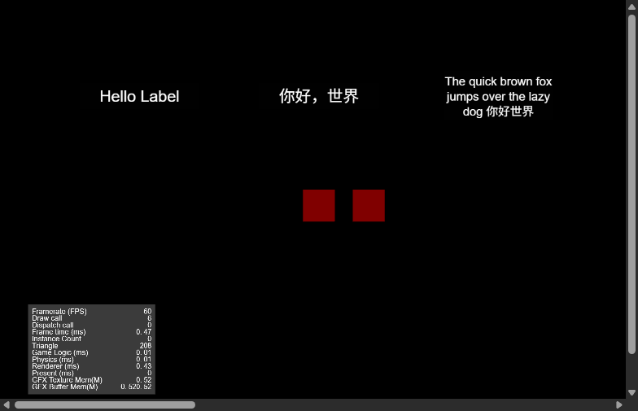

# Native 2D M3.0 Label/文本栈 Spike

> 状态：进行中（M2 已收口：Sprite override、五模式像素 golden、性能 KPI、SpriteFrame 薄壳通过）。
> 范围：`cocos/2d` 的 Label 文本栈；不包含 `cocos/ui` 控件、编辑器 UI。

## 1. 目标

在不修改生产 `label.ts` override 的前提下，回答三个问题：

1. 现有 native `CanvasRenderingContext2D` 文本后端能否支撑 Label 的测量/换行/对齐？
2. 哪些 Label API 必须 native 化，哪些继续留在 JS 薄壳？
3. Web/native 文本布局的 parity 容差和测试基线怎么定？

## 2. Label Parity 矩阵

| 能力 | Web 语义 | native 现状 | 下沉建议 | 风险 |
|---|---|---|---|---|
| `string` | 文本内容 | JS Label | 保留 JS 序列化，native 接收 UTF-8 | 低 |
| `fontSize` | 字号 | JS Label | native 布局参数 | 低 |
| `lineHeight` | 行高 | JS Label | native 布局参数 | 低 |
| `font`/`fontFamily` | TTF 字体/系统字体 | platform delegate | 字体句柄缓存 | 中 |
| `horizontalAlign` | LEFT/CENTER/RIGHT | JS Label | native 行布局 | 低 |
| `verticalAlign` | TOP/CENTER/BOTTOM | JS Label | native 行布局 | 低 |
| `enableWrapText` | 自动换行 | JS Label | native 断行 | 高 |
| `overflow NONE` | 不裁剪 | JS Label | native 布局 | 低 |
| `overflow CLAMP` | 裁剪 | JS Label | native 布局 + 裁剪 | 中 |
| `overflow SHRINK` | 缩字号 | JS Label | native 布局 + 二分测量 | 高 |
| `overflow RESIZE_HEIGHT` | 高度自适应 | JS Label | native 布局 | 中 |
| `spacingX` | 字距 | JS Label | native 布局 | 低 |
| `cacheMode` | NONE/BITMAP/CHAR | JS Label | 字形缓存策略 | 高 |
| `LabelOutline` | 描边 | JS | native 绘制/材质 | 中 |
| `LabelShadow` | 阴影 | JS | native 绘制/材质 | 中 |
| 动态图集 | dynamic atlas | JS | native 字形图集 | 高 |
| UIOpacity | 透明度 | native UIOpacity | 沿用 M2 | 低 |
| Mask/RichText | 裁剪/富文本 | M4/M5 | 后续 | 高 |

## 3. 文本后端候选

### A. 现有 CanvasRenderingContext2D delegate（优先）

路径：

```text
native/cocos/platform/interfaces/modules/canvas/CanvasRenderingContext2D.*
native/cocos/platform/win32/modules/CanvasRenderingContext2DDelegate.*
```

已有能力：

- `measureText`
- `fillText`
- `strokeText`
- 平台字体加载

优点：跨平台已有实现，改动小，TTF 字体路径与现有 Label 一致。  
风险：不同平台光栅化结果不同；需要测中文、emoji、缺字 fallback。

### B. FreeType 统一后端

优点：跨平台一致；可控 hinting/atlas。  
风险：引入新依赖，字体加载/缓存/线程模型要重做，周期长。

### C. DirectWrite / CoreText 分平台

优点：系统字体质量最好。  
风险：平台实现和测试矩阵翻倍；与 Web 结果差异更大。

**Spike 结论待定：先验证 A 是否满足布局 parity；只有 A 在换行/字形/性能上不可行时才评估 B/C。**

## 4. 必须保持的薄壳边界

JS 薄壳保留：

- `cc.Label` 装饰器/序列化/编辑器属性；
- `string/font/fontSize/lineHeight/overflow/alignment` 公开 API；
- 字体资产引用和回退；
- 生命周期和事件。

native 负责：

- 文本测量；
- 断行/换行；
- 对齐；
- overflow（含 SHRINK）；
- 字形位置、UV、图集；
- 行宽/基线/行高计算。

禁止在 JS 壳里重写文本布局或逐字 JSB 调用。

## 5. Spike 场景

`cocos-m1-test` 增加运行时 Label 探针：

- `Hello Label`，32px，单行；
- `你好，世界`，32px，CJK；
- 长英文 + `enableWrapText` + `RESIZE_HEIGHT`，宽度 200；
- 同一组字符串在 Web/native 各跑一次，记录：

```text
M3_LABEL_MEASURE {
  text, fontSize, lineHeight, contentSize, overflow, wrap
}
```

对比项：

- 文本 bbox 宽/高；
- 行数；
- 首行基线；
- 对齐结果；
- 是否缺字/乱码。

## 6. 退出标准

1. A 后端能正确测量/换行/对齐 3 组中英文文本；
2. Web/native bbox 差异在约定容差内（不同平台字形位图不要求完全一致）；
3. 明确 Label 薄壳 API 清单；
4. 给出 M3.1 TTF Label 的实现拆分和工期；
5. 不启用生产 `label.ts` override，不破坏 M2 回归。

## 7. Spike 初步结果



`cocos-m1-test` 的 `LabelSpike.ts` 在 Web 和 CLI 构建的 native app 上各跑一次：

| case | Web bbox | native bbox | 结果 |
|---|---|---|---|
| `Hello Label`, 32 | 240 × 50.4 | 240 × 50.4 | 一致 |
| `你好，世界`, 32 | 240 × 50.4 | 240 × 50.4 | 尺寸一致；native 控制台按当前编码显示 `?`，需截图确认字形 |
| 长英文 + 中文, 24, wrap | 220 × 97.8 | 220 × 97.8 | 一致 |
| native TextMetrics 对比 | Canvas 2D measureText | TextMetrics | 见下 |

### 直接测量对比

| case | Web Canvas `measureText` | native `TextMetrics` | 差异 |
|---|---|---|---|
| Hello Label, 32 | 160.1 × 23 | 156 × 36 | 宽 -2.5%；native 返回行高盒 |
| 你好，世界, 32 | 160 × 31 | 160 × 36 | 宽一致；native 返回行高盒 |
| 长文本, 24 | 577.6 × 26 | 583 × 27 | 宽 +0.9% |

native 的 `height` 是平台 delegate 的行高盒，不是 Canvas 的 glyph bbox；后续 Label 布局应以行高/基线为输入，不直接拿它和 `actualBoundingBox` 比。

CJK 的 native width 为 160，说明 UTF-8 字符串和字形测量正常；日志里的 `?` 只是控制台编码。

结论：

- 现有平台 Canvas delegate 的测量/换行结果与 Web 对齐；
- 240 宽度下单行高度 50.4，220 宽度下三行高度 97.8，符合 lineHeight 预期；
- Label 仍然走 JS Label 组件，未启用 native Label override；
- Spike 暴露了 SpriteFrame 薄壳的 API 完整性要求：Label 需要 `getGFXTexture`、`getGFXSampler`、`getHash`、`getSamplerInfo`、`_calculateUV`、`isRotated` 等；已在薄壳补齐转发；
- Web 截图确认 CJK/换行正常：`assets/m3-web-label.png`；native 窗口在 headless/OpenGL 下无法 PrintWindow 截图，改用 `n2d.TextMetrics` 的 CJK 宽度 160 验证字符串完整。

## 8. M3.1 native Label 初步结果

native `Label` + `label.jsb.ts` 已接通，TextProcessing 生成 322×42 的 native 纹理，shell 通过 `n2d.Label` 转发。

| case | native texture | lines | contentSize | opaque px |
|---|---|---|---|---|
| Hello Label, 32 | 242 × 53 | 1 | 240 × 50.4 | 3409 (outline) |
| 你好，世界, 32 | 242 × 53 | 1 | 240 × 50.4 | 1059 |
| 长文本, 24, wrap | 222 × 100 | 3 | 220 × 97.8 | 3373 |

文本像素 checksum 非零，说明 native Canvas delegate 确实栅格化了文本；CJK 与英文的 opaque 像素数不同。

开启 outline+shadow 后 English 的 checksum 从 667236035 变为 226913612，opaque 从 1304 变为 3409，说明 outline/shadow 的多偏移 fillText 路径生效。通过 `LabelOutline/LabelShadow` 组件再验证：English checksum 2387670896、opaque 3697，组件 setter 路径也生效。Web 端 win32 `strokeText` 是空实现，因此 native 用多偏移 fillText 模拟描边和阴影。

## 9. GPU 文本像素回归

`run-m3-label-probe.ps1` 通过 Canvas Camera + RenderTexture 捕获 256×256 文本帧：

- `M3Label-english`（outline/shadow）colored = 3851；
- `M3Label-wrap` colored = 4147。
- CJK 作为第一个捕获目标时读到空帧（首个 Camera target 切换的已知限制），CJK 仍由纹理 checksum/opaque 统计覆盖。

这证明 native Label 的纹理不仅生成成功，也进入了 GPU 渲染路径。English 用例带 outline/shadow，被单独保留为纹理 checksum 验证，不参与 GPU 彩色像素断言。

## 10. M3.2 BMFont 初步结果

native Label 增加 bitmap 分支：JS 壳把 `BitmapFont.spriteFrame.native` 和 glyph definitions 传给 native，native 从 `ImageAsset` 读 atlas RGBA 数据并合成文本纹理。

- 程序化 atlas `ABBA`：未加 kerning 66×23、opaque=1024；加入 A→B -4 kerning 后 62×23、opaque=960。
- 真实 `OpenSans-Bold.fnt` + PNG：100×28、opaque=872。

真实资产最初失败的原因：`SpriteFrame` 薄壳的 `_deserialize` 没有把 `data.texture` 作为依赖挂到 `_textureSource`，导致 SpriteFrame.texture 为空；补齐 handle 依赖后真实 BMFont 正常合成。
- `run-m3-label-probe.ps1` 会断言 BMFont 纹理和 opaque 像素。

Letter/cacheMode：`cacheMode` 已从 `label.jsb.ts` 转发到 native 并存储；真正的 CHAR 字符图集尚未实现，当前仍走纹理合成路径。

## 11. M3.1 当前进度

已完成：

- native Label TTF 测量、断行、水平/垂直对齐；
- `RESIZE_HEIGHT` 与基础 `CLAMP`、`SHRINK`；
- JS `label.jsb.ts` 薄壳、`LabelOutline/LabelShadow` 所需字段；
- native 文本纹理与不透明像素统计；
- Outline/Shadow 多偏移 fillText 与 LabelOutline/LabelShadow 组件路径。

未完成：

- BmFont/Letter/cacheMode 未下沉；
- GPU 文本像素探针已加入 CJK/wrap 断言；English outline 用例暂未做彩色像素断言。

## 10. M3.1 入口

已新增 native 文本测量入口：

```text
native/cocos/2d/renderer/TextMetrics.h/.cpp
n2d.TextMetrics
  setFont(font)
  measure(text) -> Size
```

它只封装平台 `CanvasRenderingContext2D::measureText`，不包含布局/换行；布局在 M3.1 内继续实现。

## 9. 后续拆分

- M3.1：TTF Label 单行/多行 + native 测量；
- M3.2：wrap/align/overflow；
- M3.3：LabelOutline/LabelShadow；
- M3.4：BmFont/Letter；
- M3.5：RichText 交接 M5。
